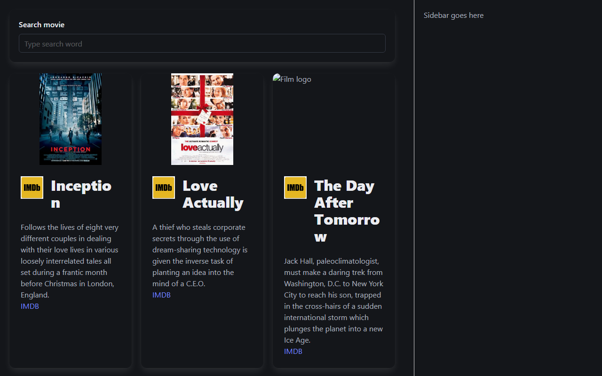

# Movies list with search – React

React app that filters a list of movies as you type.

**[▶ Live demo](https://natakovbasniuk.github.io/react_movies-list-filter-js/)**



## What I implemented
- Controlled search input; the query is stored with `useState`
- Live filtering by movie title and description
- Case-insensitive search that ignores leading and trailing spaces
- Rendering the filtered list with components and props

## Tech stack
React, JavaScript, Vite

## Run locally
```bash
npm install
npm start
```

---
Course project at [Mate Academy](https://mate.academy): the task and layout were provided by the course, the React logic is my implementation.
